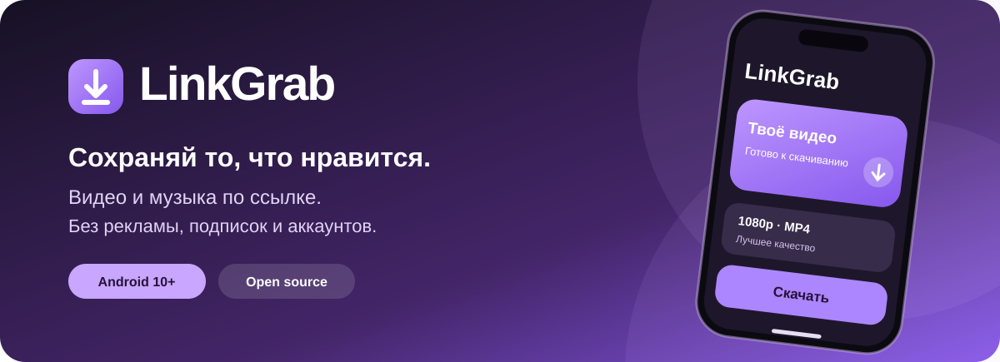

<div align="center">



**Видео и музыка по ссылке. Бесплатно. Красиво. На твоём телефоне.**

[](https://developer.android.com/)
[](https://kotlinlang.org/)
[](LICENSE)
[](https://github.com/hvhonelove/LinkGrabAndroid/actions/workflows/android-apk.yml)

### [📥 Скачать APK](https://github.com/hvhonelove/LinkGrabAndroid/releases) · [💻 Исходники](https://github.com/hvhonelove/LinkGrabAndroid) · [🐛 Сообщить об ошибке](https://github.com/hvhonelove/LinkGrabAndroid/issues/new/choose)

🇷🇺 Русский · [English](#english)

</div>

---

## ✨ Что такое LinkGrab?

**LinkGrab** — бесплатный видеозагрузчик для Android с аккуратным интерфейсом в iPhone-style. Вставь ссылку или воспользуйся меню «Поделиться», посмотри доступные форматы, выбери качество и сохрани видео или аудио на телефон.

**Без рекламы, подписок, обязательной регистрации и собственного сервера.** Работа с медиа происходит локально через [yt-dlp](https://github.com/yt-dlp/yt-dlp) и [FFmpeg](https://ffmpeg.org/). Сеть нужна для связи с видеосайтом.

| 🎬 Видео | 🎧 Аудио | 💜 Комфорт |
| :--- | :--- | :--- |
| Выбор доступного качества | M4A и MP3 | Превью с обложкой и названием |
| MP4 / WebM | Сохранение музыки | Фоновая очередь и уведомления |
| TikTok, VK, X, YouTube | Работа без своего сервера | История, поиск, светлая/тёмная тема |

## 🌐 Источники

| Платформа | Поддержка |
| --- | --- |
| **YouTube** | Обычные видео и Shorts, если доступны через yt-dlp |
| **X / Twitter** | Видео из публичных публикаций |
| **TikTok** | Длинные и короткие ссылки. Приоритет потокам без водяного знака, если они доступны |
| **VK Видео** | Ссылки vk.com и vkvideo.ru |
| **Другие** | Сайты, распознаваемые текущим экстрактором yt-dlp |

> Совместимость зависит от платформы и актуальности движка. LinkGrab не удаляет водяные знаки, встроенные в видеокадры, не обходит DRM и не обещает скачивание закрытых материалов.

## 📲 Установка за минуту

1. Открой [**Releases — скачать LinkGrab**](https://github.com/hvhonelove/LinkGrabAndroid/releases).
2. Выбери последний релиз и скачай файл **LinkGrab-*.apk** из раздела **Assets**.
3. Открой APK через **Мои файлы → Загрузки** и разреши установку из этого источника, если Android попросит.
4. Вставь ссылку в LinkGrab, посмотри предпросмотр, выбери качество и нажми **«Скачать»**.

**Требования:** Android 10+, ARM64. Основная сборка проверяется в GitHub Actions и на Android-эмуляторе; пользовательская работа подтверждена на Samsung.

**Важно про обновления:** текущий публичный *preview APK* подписан временным debug-ключом GitHub Actions. Из-за разных подписей для следующих сборок может понадобиться переустановка. Удаление приложения стирает его историю и настройки; видео в общих папках устройства обычно сохраняются. Для устойчивых обновлений нужен отдельный долговременный релизный ключ.

## ⚡ Что внутри

- **Анализ ссылки:** название, обложка, автор, длительность и доступные форматы.
- **Скачивание:** выбранное качество, видео или аудио, повтор при сбоях, пауза и продолжение, где поддерживается.
- **Фоновая работа:** уведомления, прогресс, очередь загрузок.
- **Медиатека:** поиск, просмотр, повтор, переименование, отправка и удаление.
- **Темы:** светлая, тёмная и системная, с фиолетовыми акцентами.
- **Автообновление yt-dlp:** проверка на первом использовании и при некоторых ошибках без лишних повторных запросов; работа с встроенной версией, если обновление недоступно.
- **Файлы:** видео — `Movies/LinkGrab`, аудио — `Music/LinkGrab`.

## 🔐 Бесплатно и приватно

LinkGrab не требует аккаунта, не содержит рекламы, платных функций, собственной аналитики или собственного сервера. История и настройки хранятся на устройстве. Приложение обращается к выбранным видеосайтам и их CDN за медиа, к хостингам миниатюр за изображениями и к GitHub за обновлениями.

Смотри [политику конфиденциальности](PRIVACY.md) и [уведомления о сторонних компонентах](THIRD_PARTY_NOTICES.md).

## 🛠️ Собрать самостоятельно

**Kotlin · Jetpack Compose · MVVM · Room · DataStore · Foreground Service · yt-dlp · FFmpeg**

Нужны JDK 17, Android SDK Platform 36 и Build Tools 35.0.0. Используется Gradle Wrapper 8.11.1.

```bash
git clone https://github.com/hvhonelove/LinkGrabAndroid.git
cd LinkGrabAndroid

./gradlew :app:assembleDebug :app:testDebugUnitTest :app:lintDebug
# Windows: gradlew.bat :app:assembleDebug
# APK: app/build/outputs/apk/debug/app-debug.apk
```

Для x86_64-эмулятора передай `-PtestAbi=x86_64`; для большинства современных Android-телефонов стандартная сборка ARM64.

Документация: [Архитектура](ARCHITECTURE.md) · [История изменений](CHANGELOG.md) · [Разработка и вклад](CONTRIBUTING.md) · [Безопасность](SECURITY.md).

GitHub Actions выполняет unit-тесты, lint и инструментальные тесты на эмуляторе с настоящими yt-dlp, FFmpeg и MediaStore.

## ❓ Частые вопросы

<details><summary><b>Почему не скачивается видео?</b></summary>

Сайт может изменить способ выдачи видео, ограничить доступ к CDN или потребовать входа. LinkGrab умеет автоматически проверять обновления yt-dlp и повторять часть ошибок. Открой детали неудачной загрузки, чтобы увидеть техническую причину.

</details>

<details><summary><b>TikTok сохраняется без водяного знака?</b></summary>

Если платформа отдаёт чистый видеопоток, LinkGrab отдаёт ему приоритет. Когда логотип уже находится в кадрах, убрать его автоматически нельзя. Результат зависит от конкретного видео и версии yt-dlp.

</details>

<details><summary><b>Куда сохраняются файлы?</b></summary>

Видео: `Movies/LinkGrab`. Аудио: `Music/LinkGrab`. Ищи их через галерею или «Мои файлы».

</details>

<details><summary><b>Почему APK не ставится поверх старой версии?</b></summary>

Предварительные CI-сборки подписываются различными debug-ключами. Для обновления без потери локальной базы будет нужен стабильный релизный сертификат.

</details>

## 🤝 Открытый исходный код

LinkGrab распространяется по лицензии **[GNU GPL-3.0-only](LICENSE)**. Код можно изучать, изменять и распространять, соблюдая условия GPL и лицензии зависимостей.

Нашёл баг или хочешь предложить функцию? [Создай Issue](https://github.com/hvhonelove/LinkGrabAndroid/issues/new/choose). Не публикуй приватные ссылки, cookies и токены.

## English

**LinkGrab** is a free, open-source Android 10+ video and audio downloader with a polished violet Compose UI. Paste or share a URL, preview the video, select a format and save it to your phone. No ads, subscriptions, accounts, analytics or LinkGrab backend.

Works with public URLs supported by yt-dlp, including YouTube, X, TikTok and VK Video. Watermark-free TikTok streams are preferred where available. DRM, login-gated and inaccessible content may not work.

[Download the APK](https://github.com/hvhonelove/LinkGrabAndroid/releases) · [Source code](https://github.com/hvhonelove/LinkGrabAndroid) · [Report an issue](https://github.com/hvhonelove/LinkGrabAndroid/issues/new/choose)

---

<div align="center">
  <b>LinkGrab — сохраняй то, что нравится.</b><br/>
  Free · Open source · Made for Android
</div>
